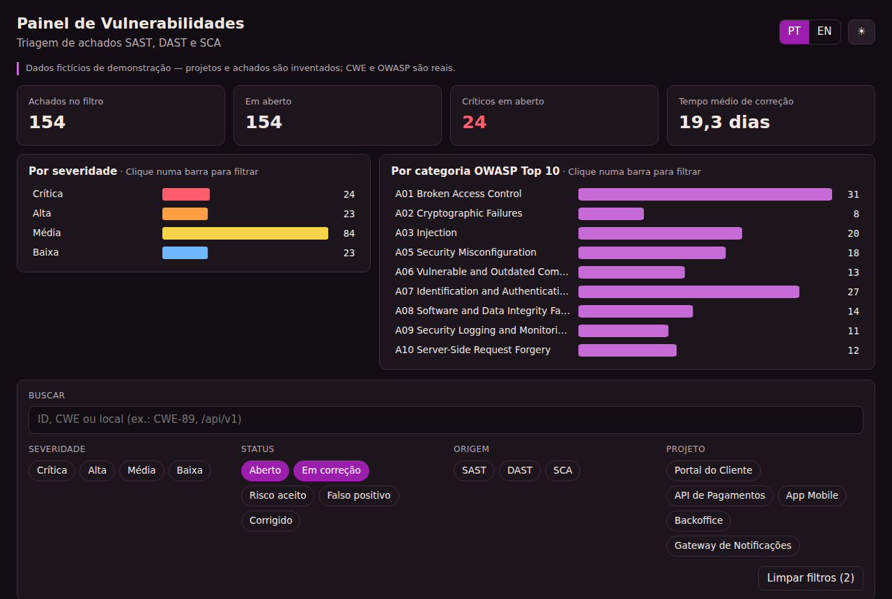
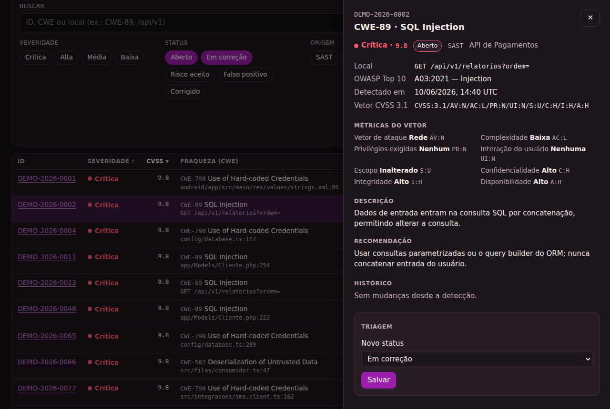

# Painel de Vulnerabilidades

Painel para triagem de achados de segurança vindos de ferramentas **SAST** (análise do código), **DAST** (teste da aplicação rodando) e **SCA** (dependências). Mostra o resumo do risco, filtra e ordena os achados, mostra o detalhe com a nota **CVSS 3.1** explicada e permite mudar o status (triagem) com justificativa.

**Demo:** `https://ademarchamineto.github.io/painel-vulnerabilidades/` · em inglês: `?lang=en`

> Os dados são **fictícios**: os projetos e os achados são inventados (IDs `DEMO-2026-xxxx`). Os nomes de CWE e as categorias OWASP Top 10 (2021) são reais.

<p>
  
  
</p>

**Stack:** Vue 3 (Composition API, `<script setup>`) · TypeScript · Pinia · GraphQL · Apollo Client (`@vue/apollo-composable`) · vue-i18n · Vite · Vitest + Vue Test Utils · ESLint (eslint-plugin-vue) · GitHub Actions + GitHub Pages

## Funcionalidades

- **Resumo:** total no filtro, em aberto, críticos em aberto e tempo médio de correção (MTTR). Gráficos em SVG por severidade e por categoria OWASP; clicar numa barra filtra a tabela.
- **Tabela:** ordenação por CVSS, severidade, projeto, status e data; paginação por cursor (estilo Relay); estados de carregando, vazio e erro com "tentar de novo".
- **Filtros:** severidade, status, origem, projeto, OWASP e busca por ID, CWE ou local (com debounce). Tudo vai para a URL, então um link compartilhado abre a mesma visão.
- **Detalhe:** local do achado, vetor CVSS com cada métrica traduzida, descrição e recomendação por CWE, e histórico de mudanças.
- **Triagem:** mudança de status com **UI otimista**. *Risco aceito* e *Falso positivo* exigem justificativa, validada também no servidor. A triagem fica salva no navegador.
- **PT/EN**, tema escuro e claro, layout responsivo.
- **Pronto para publicar:** ícones (favicon, Apple, PWA), manifest, Open Graph com imagem 1200×630, JSON-LD (`WebApplication`), sitemap, `llms.txt`, página 404 e página de privacidade. Lighthouse 90+ em performance e 100 em acessibilidade, boas práticas e SEO.
- **Estatísticas só com consentimento (LGPD):** Google Analytics 4 e Microsoft Clarity carregam apenas depois de "Aceitar". Sem os IDs configurados, nada é carregado e o aviso nem aparece.

## Arquitetura

```
src/
  domain/
    cvss.ts          cálculo da nota CVSS 3.1 a partir do vetor (spec do FIRST)
    seed.ts          dataset fictício determinístico (PRNG com semente)
  graphql/
    schema.ts        typeDefs + resolvers: filtro, ordenação, paginação, resumo, mutation
    client.ts        Apollo Client com SchemaLink (o "servidor" roda no navegador)
    operations.ts    queries, fragment e mutation tipadas
  stores/findings.ts Pinia: filtros, ordenação, pilha de cursores, sincronização com a URL
  components/        tabela, filtros, gráficos, paginação, drawer de detalhe, badges
  i18n/              mensagens PT/EN (inclui a base de descrições por CWE)
tests/               domínio, API GraphQL, store e componentes
```

### Decisões

- **GraphQL sem back-end.** O schema roda no navegador via `SchemaLink`, para a demo funcionar no GitHub Pages. Os componentes só conhecem as queries; para usar uma API real basta trocar o `SchemaLink` por um `HttpLink({ uri })` em `client.ts`.
- **A nota CVSS nunca é digitada.** Ela é calculada a partir do vetor, seguindo a fórmula da especificação 3.1, e os testes conferem com valores da calculadora oficial. A severidade sai da nota.
- **Pinia para o estado da tela, Apollo para os dados.** Filtros, ordenação e página ficam no store; os achados ficam no cache normalizado do Apollo. A mutation devolve o `Finding`, então o cache atualiza a linha e o drawer sozinho; lista e resumo são recarregados porque dependem do status.
- **Paginação por cursor**, com pilha de cursores no store para o botão "Anterior". Mudar filtro ou ordenação volta para a página 1. A ordenação desempata pelo ID para não repetir nem pular itens entre páginas (tem teste para isso).
- **Status em aberto como padrão.** A visão inicial mostra só o que precisa de ação (Aberto e Em correção).
- **Acessibilidade:**
  - colunas ordenáveis com `aria-sort` e botão no cabeçalho;
  - um tab-stop por linha (o ID), mas a linha inteira é clicável;
  - filtros como `<button aria-pressed>` dentro de `<fieldset>`;
  - drawer com `role="dialog"`, foco preso dentro, Esc fecha e o foco volta para onde estava;
  - barras dos gráficos são botões com `aria-label`.

## Rodando

```bash
npm install
npm run dev          # http://localhost:5173
npm test             # 35 testes
npm run lint
npm run type-check   # vue-tsc
npm run build
```

## Deploy

O workflow `.github/workflows/deploy.yml` roda lint, type-check, testes e build a cada push. Na branch `main`, ele publica no GitHub Pages.

Para ativar, vá em **Settings → Pages → Source: GitHub Actions**.

GA4 e Clarity (opcionais): crie as variáveis `VITE_GA_ID` e `VITE_CLARITY_ID` em **Settings → Secrets and variables → Actions → Variables**. Os IDs são públicos (vão para o JavaScript do site), por isso são variáveis e não segredos.

## Próximos passos

- Servidor GraphQL de verdade (Node + Apollo Server ou .NET + Hot Chocolate) com banco.
- Importar relatórios no formato SARIF.
- Atribuir responsável e prazo (SLA) por severidade.

## Autor

Ademar C. Neto
